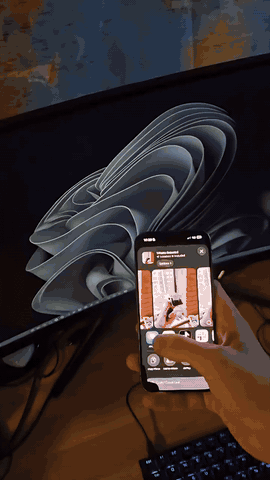
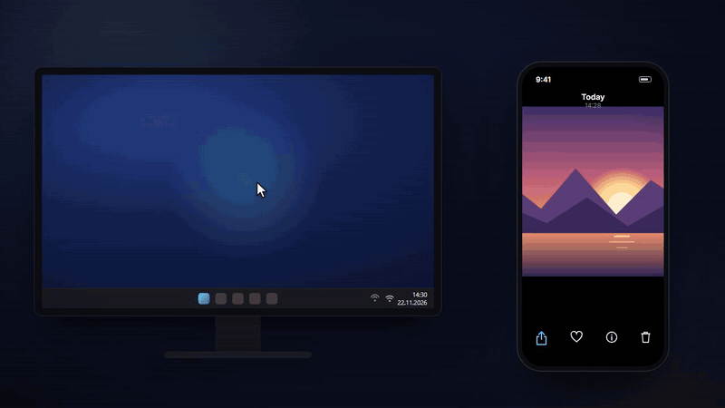

<div align="center">

# mtdrop

**AirDrop-compatible file sharing between an iPhone and a Windows 11 laptop<br>with a built-in MediaTek MT7921 Wi-Fi card.**

No app on the iPhone · no USB dongle · no Linux VM or WSL

[](https://github.com/jp10b/mtdrop/actions/workflows/ci.yml)
[](LICENSE)


<a href="docs/media/demo.mp4"></a>

<sub>iPhone → PC: the laptop shows up in the native AirDrop sheet and the photo arrives on Windows.
<a href="docs/media/demo.mp4">Full-quality video</a>.</sub>

</div>

---

> [!WARNING]
> **Working alpha, tested on one machine.** Receiving and sending work end to end on the maintainer's laptop
> (Acer Swift X, MT7921, Windows 11 25H2) with an iPhone 15 Pro on iOS 26.5.2.
> mtdrop swaps the driver of your Wi-Fi card while it runs. Read [Limitations](#limitations) before you try it.

mtdrop is an independent interoperability project. It is not affiliated with, sponsored by or endorsed by Apple Inc.
AirDrop, iPhone and Mac are trademarks of Apple Inc. They appear here only to say what mtdrop works with.

## Contents

- [What it does](#what-it-does)
- [What is new here](#what-is-new-here)
- [Limitations](#limitations)
- [Install](#install)
- [How it works](#how-it-works)
- [Building from source](#building-from-source)
- [Privacy and safety](#privacy-and-safety)
- [Other Wi-Fi cards](#other-wi-fi-cards)
- [Credits](#credits) · [Licence](#licence)

## What it does

| Feature | How it works |
|---|---|
| **Receive** | Click *Receive* in the tray app. The PC appears in the iPhone's AirDrop sheet next to Apple devices. You accept or decline each transfer on the PC, and files land in `Downloads`. |
| **Send** | Right-click files in Explorer → *Send to → iPhone (mtdrop)*, or use the tray menu. Nearby iPhones are listed, you pick one, and the owner accepts on the phone. |
| **Gives Wi-Fi back by itself** | A session takes over the Wi-Fi card for up to 2 minutes. A Windows service always hands it back to the MediaTek driver afterwards, even if a process crashes or the laptop restarts. |

### Receiving a photo, step by step

<p align="center">
  <a href="docs/media/how-it-works.mp4"></a>
</p>

1. On the PC, click the mtdrop icon in the notification area and choose **Start receiving**. The PC stays visible for 2 minutes.
2. On the iPhone, set AirDrop to **Everyone for 10 Minutes** (Control Centre or *Settings → General → AirDrop*).
3. Share a photo, tap **AirDrop** and choose your PC.
4. On the PC, click **Accept**. The photo is saved to `Downloads`; *Open folder* shows it.

### Measured on the test machine

| What | Time |
|---|---|
| Click on *Send* until the radio is up | ~6 s |
| 5.4 MB photo PC → iPhone, upload | ~4 s (~1.4 MB/s); ~15 s from the click to "Delivered" |
| 1.8 MB photo iPhone → PC | ~350–590 kB/s (measured before the faster data path) |
| End of transfer until Wi-Fi is connected again | ~16 s |

Every number comes from a numbered experiment in [`docs/FINDINGS.md`](docs/FINDINGS.md).

## What is new here

As far as we know, mtdrop is the **first working AirDrop-compatible implementation for a MediaTek Wi-Fi card on Windows**.
The approach itself is not new: [winawdl](https://github.com/raph559/winawdl) (Realtek) and
[AirDrop-for-Windows](https://github.com/21Suspect/AirDrop-for-Windows) (Intel) showed that a Windows PC can speak AWDL
by driving its own Wi-Fi card, and mtdrop's architecture follows winawdl. What this project adds:

- **MT7921 bring-up from user mode.** The firmware boot, DMA rings, raw RX/TX and channel switching of the Linux mt76 driver,
  ported to a portable C library ([`driver/mt792x/`](driver/mt792x/)). The DMA memory is built from ordinary 4 KiB pages,
  so a session does not need large locked blocks of low memory.
- **Two changes to [OWL](https://github.com/seemoo-lab/owl)** that should help any OWL port with a radio behind a pipe or a queue
  (both marked "mtdrop" in the source):
  - **Frames dated by the radio** ([`awdld/owl/src/rx.c`](awdld/owl/src/rx.c), F-022/F-023): OWL dates a received frame
    when it processes it, which under load can be over a second late and puts the AWDL slot schedule out of step with the
    iPhone. With `OWL_RADIOTAP_TSFT_IS_HOST_CLOCK`, OWL uses the arrival time the radio wrote into the radiotap TSFT field.
    This was the difference between the PC not appearing in the share sheet and a working transfer.
  - **Slot-aware hand-over** ([`awdld/owl/daemon/core.c`](awdld/owl/daemon/core.c), F-034/F-039): a unicast frame goes to
    the radio only if it, and everything already queued there, can leave before the peer's shared slots end. Frames queued
    near the end of a slot used to go out after the iPhone had left the channel: given-up frames fell from 16 % to 2 %, and to 0–0.1 %
    with the station data path (F-036, F-039).
- **What the MT7921 firmware needs for AWDL**, measured and written down: the Linux firmware instead of the Windows one
  (F-007), a station record for the peer so data leaves in 1.3–3.4 ms instead of 105–130 ms (F-035), and the data rate and queue
  choices behind them (F-020, F-036).
- **A Wi-Fi give-back that survives crashes**, tested by killing each process mid-session, restarting and closing the lid
  (F-027), with saved networks restored and the reconnect nudged (F-026, F-037).
- **A lab notebook** of 39 numbered experiments, each with its prediction written before the run
  ([`docs/FINDINGS.md`](docs/FINDINGS.md)), and a [porting guide](docs/PORTING.md) for other cards.

## Limitations

- **No Wi-Fi internet during a session.** mtdrop replaces the Wi-Fi driver while it runs, for at most about 2 minutes. Ethernet and USB tethering are not affected.
- **One chip only: MediaTek MT7921** (PCIe, `PCI\VEN_14C3&DEV_7961`). Other cards need their own radio backend, see [`docs/PORTING.md`](docs/PORTING.md).
- **"Everyone for 10 Minutes" only.** "Contacts Only" needs an identity signed by Apple, which cannot be created outside Apple devices. This will not change.
- **Bluetooth must be on to send.** An iPhone lists a sender only after a Bluetooth LE signal from it.
- **Self-signed driver package.** The small radio driver is signed with a certificate created on your own PC during setup. Tested only with Secure Boot off (TODO-VERIFY with Secure Boot on).
- **Tested on one laptop and one iPhone.** Apple can change the protocol in any iOS update.
- **Firmware is not included.** mtdrop loads the MT7961 firmware published for Linux, because the Windows vendor firmware ignores the commands it needs. The setup downloads it and checks its SHA-256, see [`docs/FIRMWARE.md`](docs/FIRMWARE.md).

## Install

> [!CAUTION]
> Before the first install, create a **System Restore point** and make sure you can reach the internet **without Wi-Fi**
> (Ethernet or USB tethering), in case the Wi-Fi card has to be repaired by hand.

1. Download `mtdrop-setup-<version>.exe` from [Releases](https://github.com/jp10b/mtdrop/releases) and check its SHA-256 against the `.sha256` file next to it.
2. Run it. The setup:
   - stops unless it finds an MT7921 on the MediaTek driver;
   - downloads the MT7961 firmware (needs internet) and checks its SHA-256;
   - backs up your MediaTek Wi-Fi driver to `C:\ProgramData\mtdrop`;
   - registers the `mtdrop` Windows service and adds Start menu, *Send to* and autostart entries.

   It does not touch the Wi-Fi card until you click *Receive* or *Send*.
3. Start **mtdrop** from the Start menu. On the iPhone, set AirDrop to **Everyone for 10 Minutes**.

To uninstall, use *Settings → Apps*. It gives the card back first and removes the service, the certificate and `ProgramData\mtdrop`.
If the card is ever left on the mtdrop driver, [`scripts/wifi-giveback.ps1`](scripts/wifi-giveback.ps1) puts the MediaTek driver back.

## How it works

```
iPhone ──AWDL (802.11)──▶ radiod ──▶ awdld ──▶ airdropd ──▶ tray app
                          MT7921     AWDL       mDNS +       Receive / Send,
                          via UMDF   + awdl0    HTTPS        receiver list
                          proxy      (Wintun)   (/Discover, /Ask, /Upload)
                                 ▲
                   mtdrop service: swaps the Wi-Fi driver, watchdog, gives Wi-Fi back
```

AirDrop runs over **AWDL** (Apple Wireless Direct Link), a peer-to-peer Wi-Fi link that needs raw 802.11 frames and fast channel hopping.
Windows Wi-Fi drivers expose neither, so mtdrop drives the MT7921 itself while a session runs.

| Part | What it is |
|---|---|
| [`driver/`](driver/) | The radio backend. A small UMDF driver (`proxy/`) binds to the Wi-Fi card and relays register access. A portable chip library (`mt792x/`, ported from the Linux mt76 driver) boots the firmware and handles DMA, raw RX/TX and the channel. `radiod` serves raw 802.11 frames to one client over a named pipe ([`radio_link.h`](driver/radiod/radio_link.h)). |
| [`awdld/`](awdld/) | AWDL, based on [OWL](https://github.com/seemoo-lab/owl), with a Wintun `awdl0` adapter for IPv6. |
| [`airdropd/`](airdropd/) | The AirDrop protocol in C#: DNS-SD, TLS, `/Discover`, `/Ask`, `/Upload`, and safe archive extraction. |
| [`service/`](service/) | The elevated Windows service: swaps drivers, runs the session state machine, keeps a watchdog task and restores Wi-Fi. |
| [`app/`](app/) | The tray app (WPF): Receive, Send, the receiver list and the Accept/Decline prompt. |

Details: [`docs/ARCHITECTURE.md`](docs/ARCHITECTURE.md), [`docs/PROTOCOL.md`](docs/PROTOCOL.md).
Decisions and their reasons: [`docs/adr/`](docs/adr/). The lab notebook with every experiment: [`docs/FINDINGS.md`](docs/FINDINGS.md).

## Building from source

<details>
<summary><b>Toolchains, build order and a script install</b></summary>

> Every script that changes driver or network state prints its plan and how to undo it. Without `-Apply` it changes nothing.
> Before the first install, also export the MediaTek driver: `scripts/prepare-driver-work.ps1`.

1. Toolchains:
   - Visual Studio 2026 with the MSVC x64 tools and the Windows Driver Kit;
   - CMake and Ninja;
   - MinGW-w64 GCC (for `awdld`: OWL is GNU C);
   - .NET 10 SDK;
   - Python 3.11+ (tools and tests only);
   - Inno Setup 6 (only for the setup program).
2. Build, in this order:
   - the proxy driver: `driver/proxy`, see [`docs/DEV-SETUP.md`](docs/DEV-SETUP.md);
   - `radiod`: [`driver/radiod/README.md`](driver/radiod/README.md);
   - `awdld`: [`awdld/README.md`](awdld/README.md);
   - `dotnet publish` of `service/Mtdrop.Service` and `app/Mtdrop.App`.

   Or build everything and pack the setup program with [`installer/build-release.ps1`](installer/build-release.ps1).
3. Get the MT7961 firmware: [`docs/FIRMWARE.md`](docs/FIRMWARE.md).
4. In an elevated PowerShell:
   - `.\scripts\install-service.ps1` shows the plan;
   - `.\scripts\install-service.ps1 -Apply` installs. `-ToolsRoot` and `-FirmwareDir` point it at your build output.

   To undo: `.\scripts\install-service.ps1 -Uninstall -Apply`.

Tests that need no hardware:

```
dotnet test mtdrop.sln
python -m pytest tools
cmake -S driver/mt792x -B build/mt792x && cmake --build build/mt792x && ctest --test-dir build/mt792x
```

</details>

## Privacy and safety

- **Sending:** nothing is sent to a receiver before you choose it, and the iPhone's owner must accept.
- **Receiving:** the PC is visible only while the receive window is open (at most about 2 minutes), and nothing is saved before you accept it on the PC.
- **Logs stay on the PC.** The service logs can be read only by administrators. Logs never contain receiver names or Apple account data. The AWDL log does contain the random, regularly changing link addresses of nearby devices.
- **No private artefacts in the repository:** no firmware, packet captures, TLS key logs or private keys (CI refuses such files).
- The Bluetooth wake signal carries random hashes, not your contact details.

## Other Wi-Fi cards

Everything above `radiod` is chip-independent. To bring mtdrop to another card (Intel, Realtek, Qualcomm, MT7922, …), read [`docs/PORTING.md`](docs/PORTING.md).
It lists what the radio must be able to do, how to check that on Linux first, and the test ladder this project used for the MT7921.

## Credits

Built on the published work of others:

- [OWL](https://github.com/seemoo-lab/owl) and [OpenDrop](https://github.com/seemoo-lab/opendrop) (Secure Mobile Networking Lab, TU Darmstadt);
- [airdrop-mt7921](https://github.com/jedbillyb/airdrop-mt7921);
- [winawdl](https://github.com/raph559/winawdl);
- [AirDrop-for-Windows](https://github.com/21Suspect/AirDrop-for-Windows);
- [linux-airdrop](https://github.com/Foglio24/linux-airdrop);
- the Linux [mt76](https://github.com/openwrt/mt76) driver.

The origin and licence of every reused file is in [`third_party/NOTICE`](third_party/NOTICE). The survey of prior art is in [`docs/RESEARCH.md`](docs/RESEARCH.md).

## Licence

mtdrop is free software under the **GNU General Public License v3.0 or later**, see [`LICENSE`](LICENSE).

Some files keep the MIT, BSD-3-Clause-Clear or ISC licence of the project they come from (see their headers and [`third_party/NOTICE`](third_party/NOTICE)); all of these are compatible with the GPL.
The setup program ships the official, unmodified `wintun.dll` from [wintun.net](https://www.wintun.net/) under its own licence. MediaTek firmware is never redistributed.
